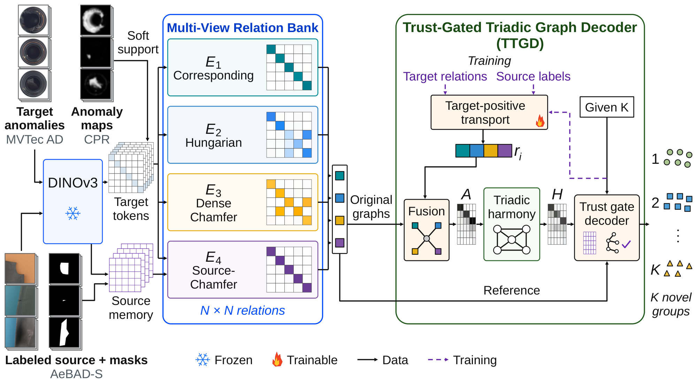

<div align="center">

# TriHarmony-NCD

### Multi-View Relations and Trust-Gated Graph Decoding<br>for Novel Class Discovery of Industrial Anomalies

**Seoyeon Oh · Dabin Kim · Taehoon Kim · Jihwan Moon · Haneol Jang**

</div>



PyTorch implementation of **Tri-Harmony-NCD**, which groups detected anomalous images into novel defect types. MVRB constructs four complementary relation graphs from frozen DINOv3 features, and TTGD learns their integration to discover defect groups with a supplied class count.

## Setting

Tri-Harmony-NCD addresses the stage after image-level anomaly detection: its inputs are the images flagged as anomalous and their anomaly maps (MuSc or CPR). The target cohorts therefore contain the anomalous test images only, 1,203 MVTec AD images (15 categories, `combined` excluded) and 392 MTD images (5 defect types), and K is the number of defect types. Labeled AeBAD-S anomalies serve as the source for both targets.

## Results

AnomalyNCD is re-run with its official implementation under the same setting (same images, anomaly maps, source data and K). Values are mean ± standard deviation over four seeds; MVTec AD is the macro-average over 15 categories.

### Without labeled normal target references (MuSc maps)

| Method | MVTec AD<br>NMI ↑ | MVTec AD<br>ARI ↑ | MVTec AD<br>F₁ ↑ | MTD<br>NMI ↑ | MTD<br>ARI ↑ | MTD<br>F₁ ↑ |
|:--|:--:|:--:|:--:|:--:|:--:|:--:|
| [AnomalyNCD](https://github.com/HUST-SLOW/AnomalyNCD) | 0.574 ± 0.017 | 0.462 ± 0.020 | 0.695 ± 0.015 | 0.313 ± 0.013 | 0.248 ± 0.005 | 0.516 ± 0.010 |
| **Tri-Harmony-NCD (Ours)** | **0.715 ± 0.002** | **0.647 ± 0.004** | **0.807 ± 0.003** | **0.391 ± 0.001** | **0.334 ± 0.001** | **0.604 ± 0.002** |

### With labeled normal target references (CPR maps)

| Method | MVTec AD<br>NMI ↑ | MVTec AD<br>ARI ↑ | MVTec AD<br>F₁ ↑ | MTD<br>NMI ↑ | MTD<br>ARI ↑ | MTD<br>F₁ ↑ |
|:--|:--:|:--:|:--:|:--:|:--:|:--:|
| [AnomalyNCD](https://github.com/HUST-SLOW/AnomalyNCD) | 0.678 ± 0.006 | 0.600 ± 0.008 | 0.780 ± 0.006 | 0.447 ± 0.024 | 0.432 ± 0.031 | 0.645 ± 0.031 |
| **Tri-Harmony-NCD (Ours)** | **0.788 ± 0.002** | **0.739 ± 0.002** | **0.873 ± 0.001** | **0.573 ± 0.029** | **0.495 ± 0.042** | **0.720 ± 0.060** |

Seeds: 42, 7, 21 and 3407 for both methods. Category-wise results are reported in Tables 3 and 4 of the paper.

## Installation

Python **3.8.16**, PyTorch **2.0.0**, CUDA **11.7**.

```bash
python3.8 -m venv .venv
source .venv/bin/activate
python -m pip install --upgrade "pip<25.1"
python -m pip install torch==2.0.0+cu117 torchvision==0.15.1+cu117 --index-url https://download.pytorch.org/whl/cu117
python -m pip install -r requirements.txt
```

Download the DINOv3 ViT-B/16 backbone:

```bash
python scripts/download_backbone.py --output /path/to/weights/dinov3_vitb16.safetensors
```

## Training and evaluation

For dataset preparation, refer to [AnomalyNCD](https://github.com/HUST-SLOW/AnomalyNCD#datasets). Normal (`good`, `MT_Free`) and `combined` folders are skipped when the target cohorts are built. Arrange the data as follows; each anomaly map has the file stem of its image, and the CPR maps for MTD are floating-point `.npy` files.

```text
DATA_ROOT/
├── AeBAD_crop/{images,masks}/<4 anomaly classes>/
├── mvtec/<category>/test/<defect type>/
├── mtd_anomaly_detection/test/<defect type>/
└── maps/{musc,cpr}/{mvtec,mtd}/
```

Run from the repository root:

```bash
python scripts/reproduce_main_tables.py \
  --data-root /path/to/DATA_ROOT \
  --checkpoint /path/to/weights/dinov3_vitb16.safetensors \
  --output /path/to/outputs \
  --device cuda:0
```

The script fits all 32 cohorts (15 MVTec AD categories and MTD, with MuSc and CPR maps) with the four seeds of the paper and writes the tables to `<output>/tables/`. Use `--seeds` to run a subset and `--dry-run` to list the planned runs without reading data.

## Acknowledgements

We thank [AnomalyNCD](https://github.com/HUST-SLOW/AnomalyNCD), [MuSc](https://github.com/xrli-U/MuSc), [CPR](https://github.com/flyinghu123/CPR), [DINOv3](https://github.com/facebookresearch/dinov3), and [timm](https://github.com/huggingface/pytorch-image-models).
